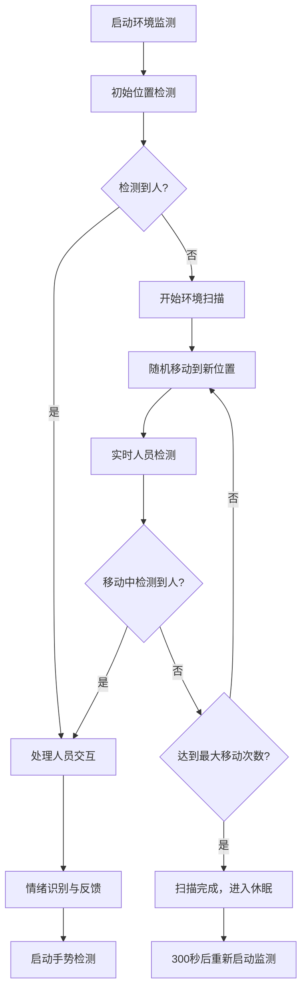

# 🌍 环境监测模块功能分析与整合方案

## 📊 模块功能概览

### 🎯 核心功能
```
EnvironMonitorModule 环境监测模块
├── 🔍 智能环境扫描
│   ├── 定时环境监测 (300秒间隔)
│   ├── 初始位置人员检测
│   ├── 全方位扫描寻找用户
│   └── 连续监测防呆保护
├── 🤖 智能移动控制  
│   ├── 随机位置移动策略
│   ├── 障碍物/悬崖安全检测
│   ├── 传感器状态实时监控
│   └── 中断保护执行机制
├── 👁️ 人脸识别与情绪检测
│   ├── 实时人脸检测
│   ├── 主人身份识别
│   ├── 情绪状态分析
│   └── 个性化情绪反馈
└── 🎭 智能交互响应
    ├── 语音播报系统
    ├── 表情动画控制
    ├── 手势检测触发
    └── 对话模式切换
```

## 🔍 详细功能分析

### 1️⃣ **环境监测流程**


### 2️⃣ **智能移动策略**
- **🎯 安全优先**: 实时传感器监测，避免碰撞和坠落
- **📍 随机路径**: 30-150度随机旋转 + 100-300mm随机移动
- **🚨 边缘处理**: 检测到边缘时自动调整移动策略
- **⏹️ 中断保护**: 任何时候检测到人员都会立即停止移动

### 3️⃣ **人员检测与识别**
- **👁️ 实时检测**: 摄像头持续监测画面中心区域
- **🆔 身份识别**: 区分主人和非主人（当前硬编码为true）
- **😊 情绪分析**: 检测开心、难过、惊讶、愤怒等情绪状态
- **💬 个性化回应**: 根据情绪状态给出不同的语音和表情反馈

## ❌ 当前问题与缺失依赖

### 🚨 **缺失的方法和变量**
```dart
// 缺失的UI动画方法
Future<void> _loadExpression(String expressionPath) async { /* 未实现 */ }

// 缺失的语音播报方法  
Future<void> speakWithInterruptProtection(String text) async { /* 未实现 */ }

// 缺失的状态变量
bool _isAnswering = false;           // 是否正在回答状态
bool _isTtsPlaying = false;          // TTS是否正在播放
String _humanEmotion = '';           // 当前检测到的人类情绪

// 缺失的表情资源数组
final List<String> _happyExpressions = [];      // 开心表情列表
final List<String> _sadExpressions = [];        // 难过表情列表  
final List<String> _surprisedExpressions = [];  // 惊讶表情列表
final List<String> _angryExpressions = [];      // 愤怒表情列表

// 缺失的辅助方法
String _getRandomExpression(List<String> expressions) { /* 未实现 */ }
Future<void> feedbackHumanEmotion(String emotion) async { /* 未实现 */ }
Future<void> _speakExitMessage(String message) async { /* 未实现 */ }
Future<void> _restartWakeWordDetection() async { /* 未实现 */ }
void _startAutoGestureDetection() { /* 未实现 */ }
void unawaited(Future future) { /* 未实现 */ }
```

### 🔧 **需要修复的代码段**
1. **TODO注释**: 多处标记需要语音与表情显示修改
2. **注释代码**: 情绪反馈功能被完全注释
3. **硬编码逻辑**: 身份识别固定返回true
4. **异步处理**: 某些异步调用缺少await

## 🔄 整合方案

### 📁 **1. 目录结构调整**
```
lib/core/modules/
├── environ_monitor_module.dart     [当前位置 ✅]
├── conversation_controller.dart    [需要整合]
├── ui_animation_module.dart       [需要整合] 
└── ...其他模块
```

### 🔗 **2. 依赖关系整合**

#### **与ConversationController整合**
```dart
// 在ConversationController中添加环境监测控制
class ConversationController extends ChangeNotifier {
  final EnvironMonitorModule _environModule = EnvironMonitorModule();
  
  // 连续对话模式状态检查
  bool get isInConversationMode => _isInConversationMode;
  bool get isTtsPlaying => _isTtsPlaying;
  
  // 为环境监测模块提供状态接口
  void setEnvironMonitorCallbacks() {
    _environModule.setStateCallbacks(
      isAnswering: () => _isAnswering,
      isTtsPlaying: () => _isTtsPlaying,
      isInConversationMode: () => _isInConversationMode,
    );
  }
}
```

#### **与UIAnimationModule整合**
```dart
// 环境监测模块需要访问UI动画功能
class EnvironMonitorModule {
  UIAnimationModule? _uiModule;
  
  void setUIModule(UIAnimationModule uiModule) {
    _uiModule = uiModule;
  }
  
  Future<void> _loadExpression(String expressionPath) async {
    if (_uiModule != null) {
      _uiModule!.setAnimation(expressionPath);
    }
  }
}
```

#### **与TTS服务整合**
```dart
// 环境监测模块需要语音播报功能
class EnvironMonitorModule {
  TencentTtsService? _ttsService;
  
  void setTTSService(TencentTtsService ttsService) {  
    _ttsService = ttsService;
  }
  
  Future<void> speakWithInterruptProtection(String text) async {
    if (_ttsService != null && !_isTtsPlaying) {
      await _ttsService!.speak(text);
    }
  }
}
```

### 🏗️ **3. 架构整合策略**

#### **Phase 1: 基础整合**
1. **补充缺失依赖**: 实现所有缺失的方法和变量
2. **接口标准化**: 统一与其他模块的接口规范  
3. **状态同步**: 与全局状态管理器同步

#### **Phase 2: 功能完善**
1. **情绪识别**: 完善情绪检测和反馈逻辑
2. **身份识别**: 实现真实的人脸识别功能
3. **手势检测**: 集成手势检测自动触发

#### **Phase 3: 性能优化**
1. **资源管理**: 优化摄像头和传感器资源使用
2. **电源管理**: 添加智能休眠和唤醒机制
3. **错误处理**: 完善异常处理和恢复机制

## 🚀 推荐整合步骤

### **Step 1: 立即修复**
```bash
1. 补充所有缺失的方法实现
2. 添加必要的状态变量
3. 修复所有编译错误
4. 添加基础的错误处理
```

### **Step 2: 系统集成**  
```bash
1. 在ConversationController中初始化环境监测模块
2. 建立与UIAnimationModule的连接
3. 集成TTS服务调用
4. 添加全局状态同步
```

### **Step 3: 功能测试**
```bash
1. 单独测试环境监测流程
2. 测试与连续对话模式的协调
3. 验证硬件控制功能
4. 检查资源释放是否正确
```

### **Step 4: 优化完善**
```bash  
1. 性能优化和内存管理
2. 添加详细的日志和监控
3. 完善用户体验细节
4. 添加配置项支持
```

## 💡 最佳实践建议

### 🔒 **安全性**
- 所有硬件控制操作都应有超时和中断保护
- 摄像头和传感器资源必须正确释放
- 添加异常情况的安全停止机制

### 📊 **性能考虑**
- 环境监测不应影响正常对话功能
- 合理控制扫描频率，避免过度耗电
- 优化图像处理性能，减少CPU占用

### 🎯 **用户体验**
- 环境监测应该是"无感知"的后台功能
- 语音提示要自然、不突兀
- 移动动作要平滑，避免突然的方向改变

### 🔧 **维护性**
- 所有配置参数应该可调节
- 添加详细的状态日志便于调试
- 模块化设计，便于独立测试和更新

这个环境监测模块功能非常丰富，是一个很好的智能化升级！通过合理的整合，它将大大提升LOOI机器人的智能交互体验。 🤖✨
